# Manual de usuario — SGP

Guía de uso del Sistema de Gestión de Peluquería para clientes, empleados y administradores. Capturas en `docs/img/` (ver también `docs/mockups.md`).

## 1. Acceso

1. Abrir `http://localhost:8080`.
2. En **Iniciar sesión** ingresar correo y contraseña. El sistema reconoce el rol y redirige automáticamente.
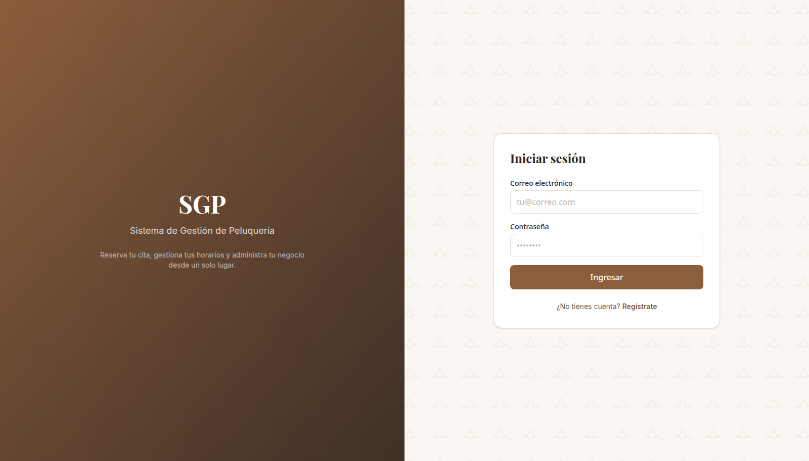

### 1.1 Crear cuenta (solo clientes)

1. En el login, pulsar **Regístrate**.
2. Completar nombre, apellido, celular (empieza con `+57`, completar los 10 dígitos), correo y contraseña.
3. Se envía un código OTP de 6 dígitos al correo; la cuenta queda activa al verificarla.

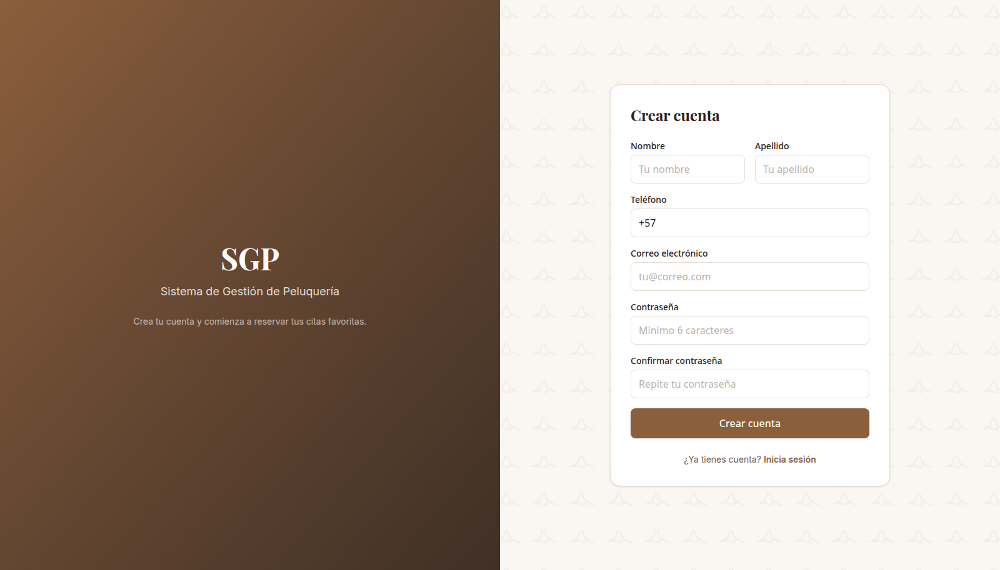

### 1.2 Verificar cuenta

1. Abrir **/verificar** (el registro redirige automáticamente).
2. Escribir el código de 6 dígitos. La pantalla muestra una cuenta regresiva: **tienes 5 minutos para verificar**.
3. Si el registro expira, la cuenta se elimina y el correo queda libre: usa "Registrarme de nuevo".
4. Si no llegó el código, usar **Reenviar código** (máximo 3 veces cada 15 minutos); el reenvío reinicia el tiempo de registro.
5. Sin verificar, el login responde "Cuenta no verificada".

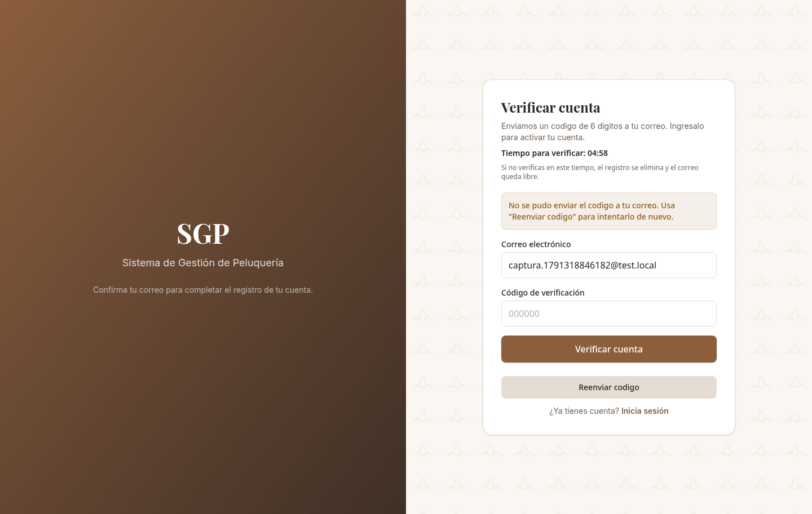

## 2. Cliente

### 2.1 Agendar una cita

1. **Paso 1 — Sede:** filtrar por departamento y ciudad, escribir el nombre de la sede o usar **Usar mi ubicación** para elegir la más cercana. También puedes seleccionar el punto en el mapa.
2. **Paso 2 — Cómo reservar:** elegir **Elegir estilista** (ves solo los servicios de esa persona) o **Buscar servicio** (ves solo los servicios de la sede y quién los realiza).
3. **Paso 3 — Servicios:** agregar uno o varios servicios. Cada uno puede tener un estilista distinto si elegiste buscar por servicio.
4. **Paso 4 — Horario:** elegir día y hora. El calendario solo muestra horas donde cabe la secuencia completa.
5. **Paso 5 — Confirmar:** revisar servicios, estilistas, duración, personas (1–5) y total.
6. **Paso 6 — Pago y QR:** se genera el código QR de ingreso y el botón **Descargar QR**. Elige efectivo en el local o pago en línea con **Wompi**; al aprobarse, la reserva queda **Confirmada** con la insignia "Pagado".

Si el horario se ocupa mientras decides, verás un error y el calendario se actualizará para elegir otro horario. Límite: 5 reservas activas.

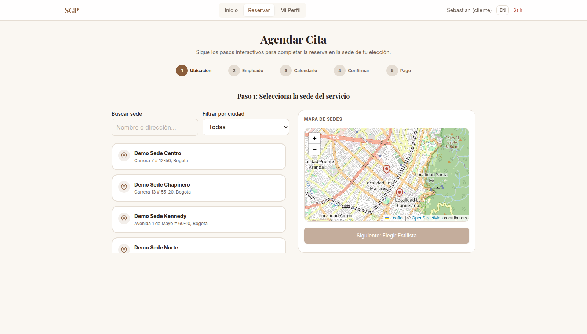

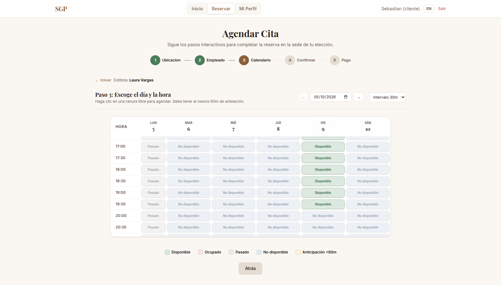

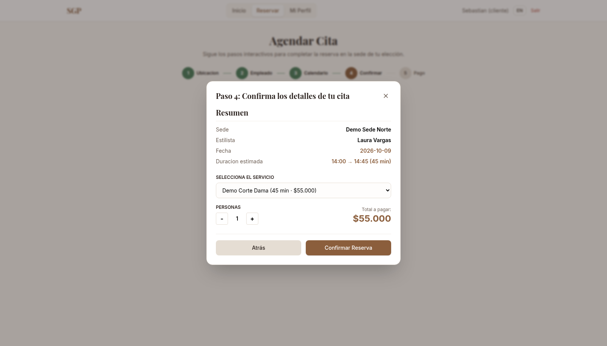

### 2.2 Mis reservas (kanban)

En **Inicio** se muestran columnas por estado: Pendiente, Confirmada, En curso, Completada y Cancelada. Al seleccionar una reserva se ve el detalle, el **mapa de la sede**, el QR y su descarga. Desde ahí puedes **cancelar** reservas pendientes o confirmadas.

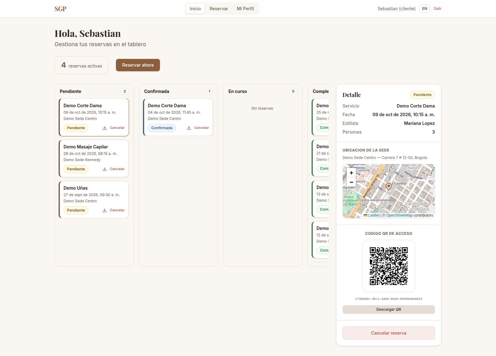

### 2.3 Mi perfil

Editar nombre, apellido, teléfono, correo y contraseña. El teléfono permite elegir el país; Colombia (+57) aparece por defecto y también puedes escribir un número internacional.

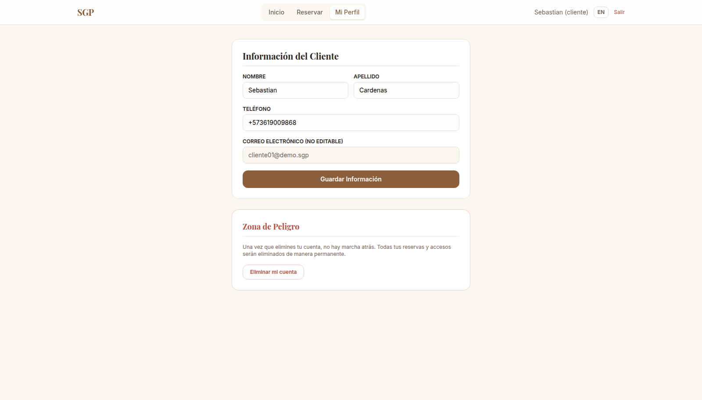

### 2.4 Mensajes

El buzón **Mensajes** reúne los avisos del salón. Cuando se cancela una cita por un imprevisto, un descanso o un cierre de sede, verás la fecha, el motivo y el estado del reembolso. El inicio muestra cuántos mensajes están sin leer y puedes marcar cada uno o todos como leídos.

## 3. Empleado

### 3.1 Citas de hoy

Timeline con color por estado y acciones rápidas:
- `[Escanear QR]`: registra la llegada del cliente y lo pone en la cola de atención.
- **Cola de atención:** muestra el cliente en atención, los que están en espera y las citas programadas, con nombre, hora y estado de pago.
- `[Atender]`: inicia el servicio. Solo aparece cuando el pago está resuelto; si terminaste antes, puedes atender al siguiente cliente sin esperar la hora.
- `[Cobrar QR]`: genera un QR de Wompi para que el cliente pague desde su celular.
- `[Efectivo]`: registra el monto recibido antes de iniciar.
- `[Finalizar servicio]`: cierra la atención y habilita al siguiente cliente.

El panel lateral muestra el mapa de la sede donde trabajas hoy y el resumen del día.

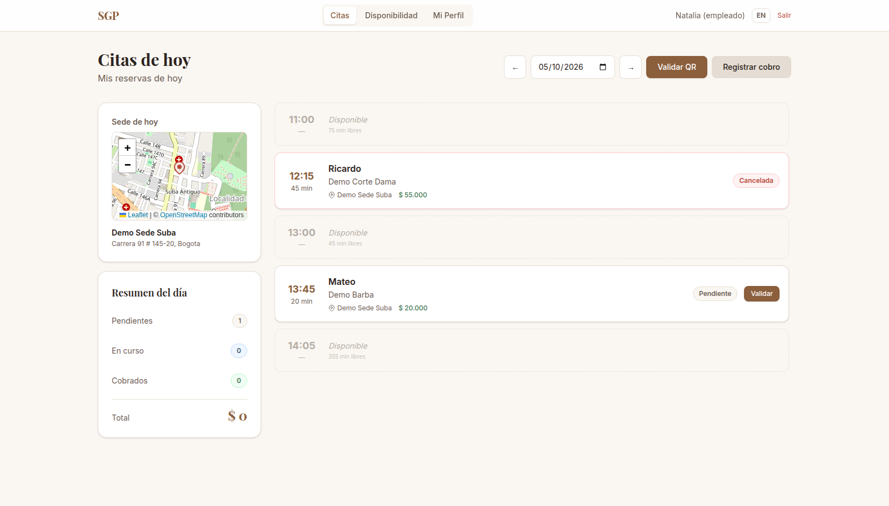

### 3.2 Validar ingreso y cobro

1. Pulsar **Escanear QR** y pegar el token, o activar la cámara y apuntar al QR.
2. El cliente aparece en la cola. Si no pagó, usa **Cobrar QR** o **Efectivo**; cuando el pago esté resuelto, pulsa **Atender**.
3. Al terminar, pulsa **Finalizar servicio**. Si terminaste antes de la hora, el sistema te muestra al siguiente cliente en espera.
2. Elegir método y monto (0 para pago online) y confirmar.
3. El sistema valida estado y ventana ±120 minutos; si todo está bien muestra "Check-in y cobro registrados". Un segundo intento avisa "La reserva ya fue cobrada".

### 3.3 Mi disponibilidad

Vista kanban semanal: cada día tiene una sede fija, un horario y uno o más descansos. La semana se repite hasta que la edites. Puedes filtrar por sede, estado y ubicación, y navegar semanas con Hoy/←/→. El estado efectivo combina el horario base, los cambios temporales, los festivos, los cierres y los bloqueos.

El panel de descanso se guarda automáticamente al tocar un día: elige **Todo el día** o uno o varios **rangos de horas** (con **Agregar otro**) y el cambio queda aplicado sin pulsar otro botón. Si el descanso se cruza con citas futuras, el sistema muestra las citas afectadas y pide confirmación antes de cancelarlas y notificar a los clientes. En el calendario del cliente, todas las franjas de descanso aparecen como **Descanso** y no se pueden seleccionar.

La pestaña **Cambios temporales** permite trabajar en otra sede durante un rango de fechas; los días se eligen uno por uno. Al terminar vuelve automáticamente a la sede base, salvo que elijas otra. La pestaña **Festivos** muestra los festivos abiertos por el administrador; si quieres trabajar, marca "Quiero trabajar" y ajusta el turno de ese día.

En el editor de un día puedes reportar un **imprevisto**: se cancelan las citas completas de ese día, se avisa a los clientes y se bloquea la fecha. Los pagos con tarjeta se intentan reembolsar; los pagos por otros medios quedan pendientes de gestión. Los pagos locales no generan devolución.

Si cambias la sede de un día con reservas futuras se pide confirmación y se cancelan con el motivo **"El empleado cambió de sede"**.

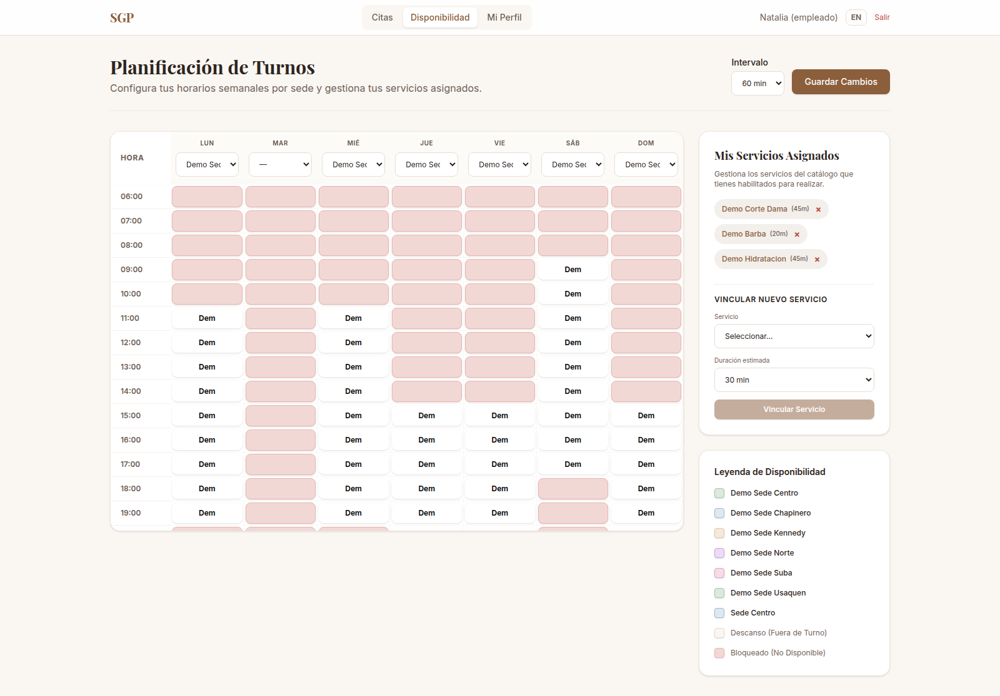

### 3.4 Mi desempeño

En la cola y en la agenda, la tarjeta **Mi desempeño** muestra el mes seleccionado con dos datos: **Cortes realizados** (todos los servicios cobrados y no reembolsados) y **Ganado** (tu parte según el porcentaje de comisión). Puedes navegar con ←/→ entre meses. El cálculo usa el mismo criterio que la nómina del administrador.

Tu foto es opcional y se edita desde **Perfil**; el administrador también puede subirla o quitarla desde **Equipo**. Si no tienes foto, el cliente verá tus iniciales.

## 4. Administrador

### 4.1 Dashboard

- **KPIs:** recaudación del día, reservas del día, tasa de ocupación promedio y clientes recurrentes.
- **Timeline:** todas las citas del día, filtrable por fecha y sede; botón Validar por cita.
- **Gestión:** accesos de gestión. Empleados, Servicios, Presentación, Sedes, Horarios/Agenda, Reportes, Moderación de clientes y Logs abren páginas independientes dentro del panel; Validar QR y Cobro se mantienen como ventanas flotantes.

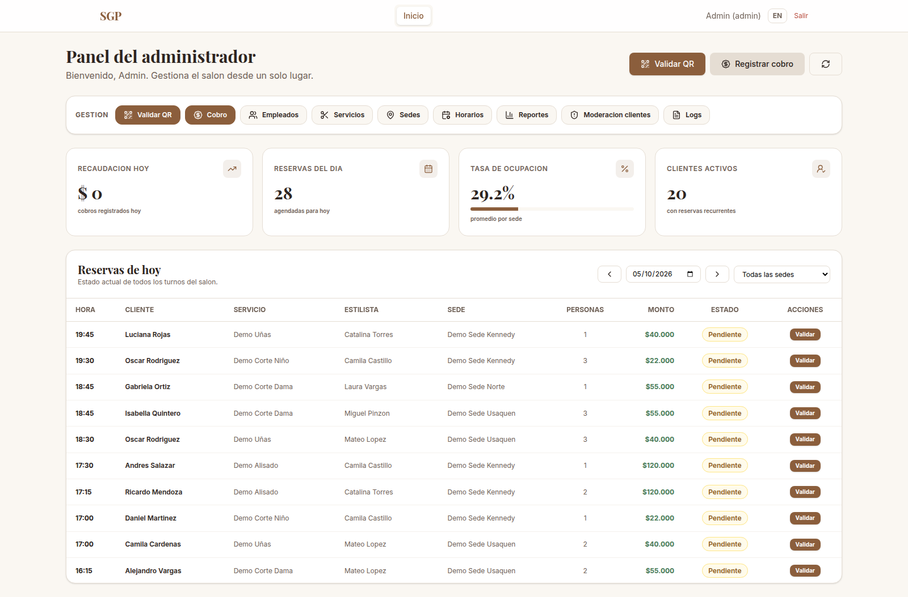

### 4.2 Planificador de horarios

1. Abrir **Horarios** (pestaña "Planificador por empleado").
2. La matriz muestra empleados (filas) por LUN–DOM (columnas) con la sede y turno de cada día, y las citas reales encima.
3. Hacer clic en una celda para editar: sede del día, hora inicio/fin o descanso. El modo **Seleccionar días** permite aplicar horarios, cerrar días o restablecer varios días a la vez.
4. Si cambias la sede de un día con reservas futuras, se advierte y al guardar se cancelan con el motivo correspondiente; verás el conteo en un aviso.
5. Usar búsqueda, filtro por sede, "Solo con horario" y navegación de semanas (Hoy/←/→). Clic en una cita pendiente abre el modal de validación.

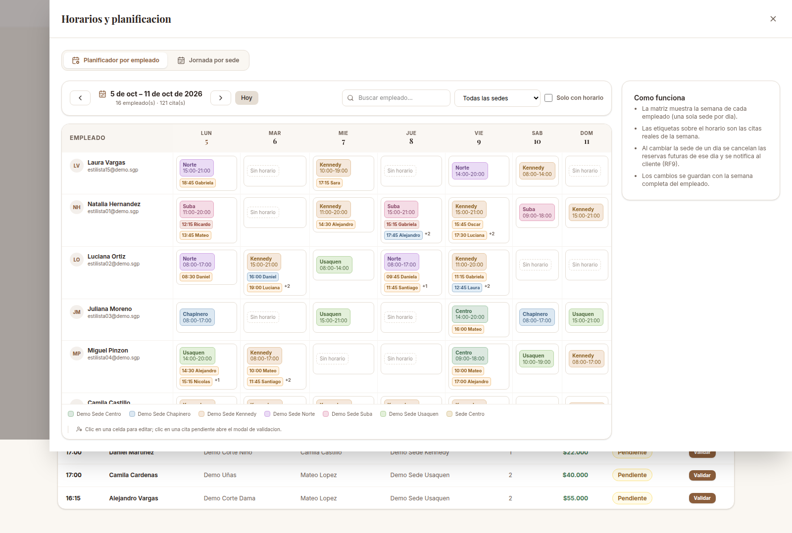

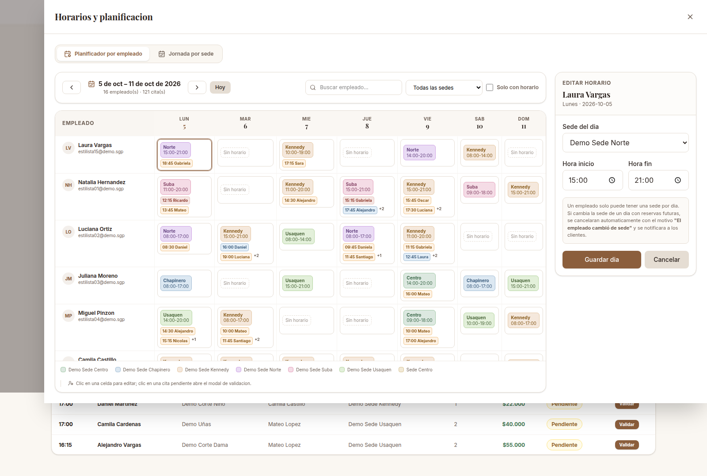

La pestaña **Jornada por sede** permite definir la plantilla semanal fija, abrir festivos en una o varias sedes y editar excepciones por fecha. La tarjeta **Horario general de sedes** aplica la misma apertura, cierre y días a todas las sedes con una sola confirmación.

En **Reportes → Nómina** el administrador elige empleado (o todos), sede (o todas) y período (mes, quincena o rango). El cálculo usa solo servicios completados y pagados, aplica el porcentaje configurado en Equipo y permite descargar un PDF.

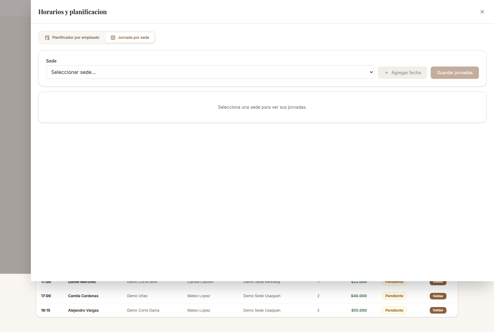

### 4.3 Empleados, servicios y sedes

- **Empleados y administradores:** al crear una cuenta eliges el rol Empleado o Administrador. Los administradores no tienen sedes, horarios ni comisión. Puedes editar sus datos y eliminar cuentas, con protección para tu propia cuenta y el último administrador. En empleados puedes subir, cambiar o quitar la foto; si no tiene, el cliente verá sus iniciales.
- **Sedes:** al crear o editar, haz clic en el mapa (o arrastra el marcador) para fijar latitud y longitud; también puedes usar **Usar mi ubicación**. Puedes agregar hasta 6 imágenes del local, ordenarlas y elegir la portada; solo el admin las edita y clientes/empleados abren la galería en un modal.
- **Servicios:** CRUD y tiempos por empleado.

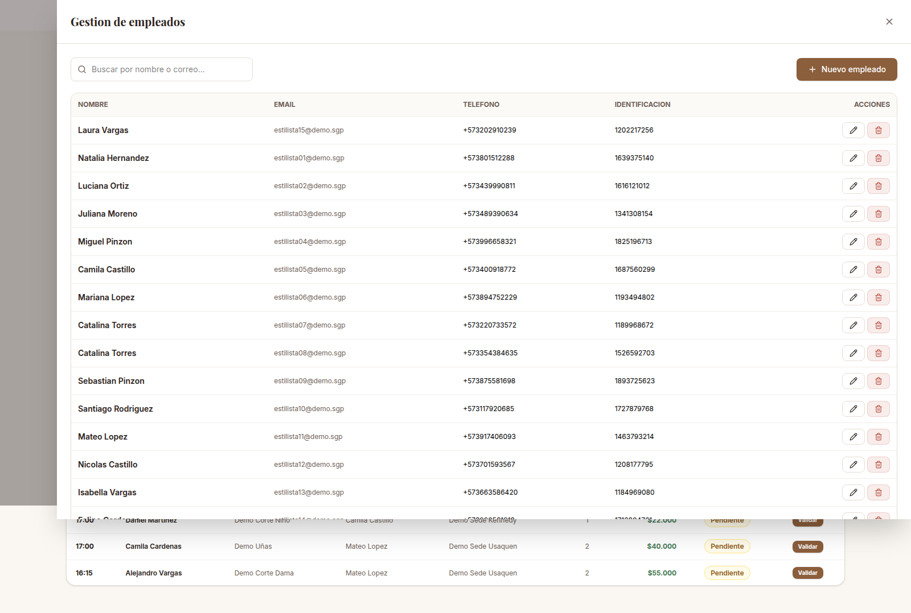

### 4.4 Reportes, clientes y logs

- **Reportes:** ventas diarias con desglose, ocupación con porcentaje por sede y clientes recurrentes.
- **Moderación de clientes:** bloquear con motivo, desbloquear y eliminar (solo con 3+ no-shows).
- **Logs:** `logs.txt` (actividad) y `errores.txt` (fallos) con búsqueda, fecha, severidad y exportación `.txt`.

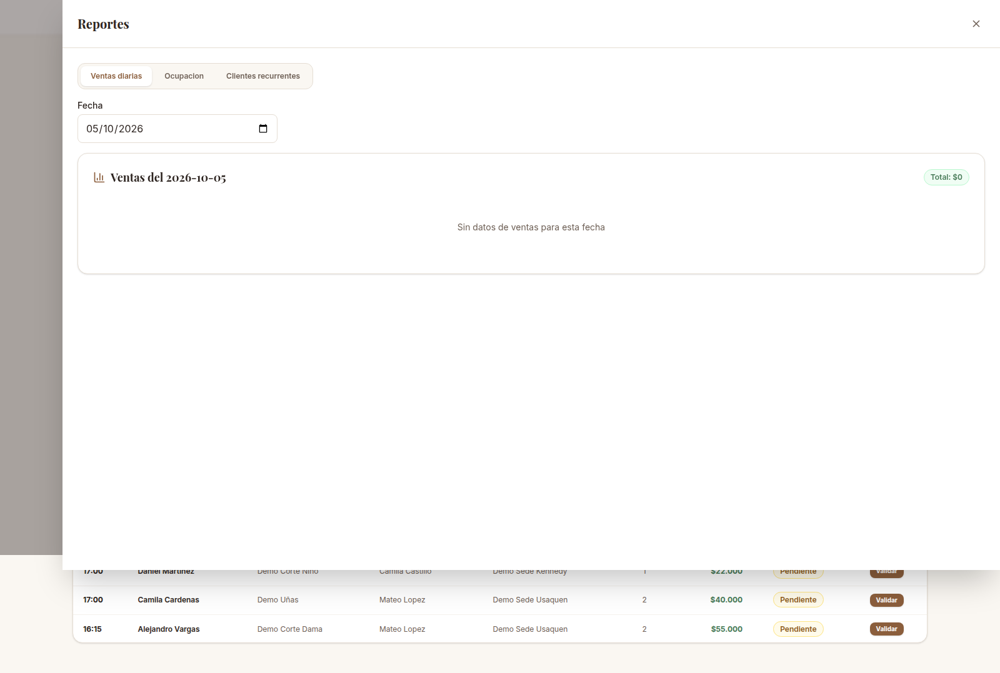

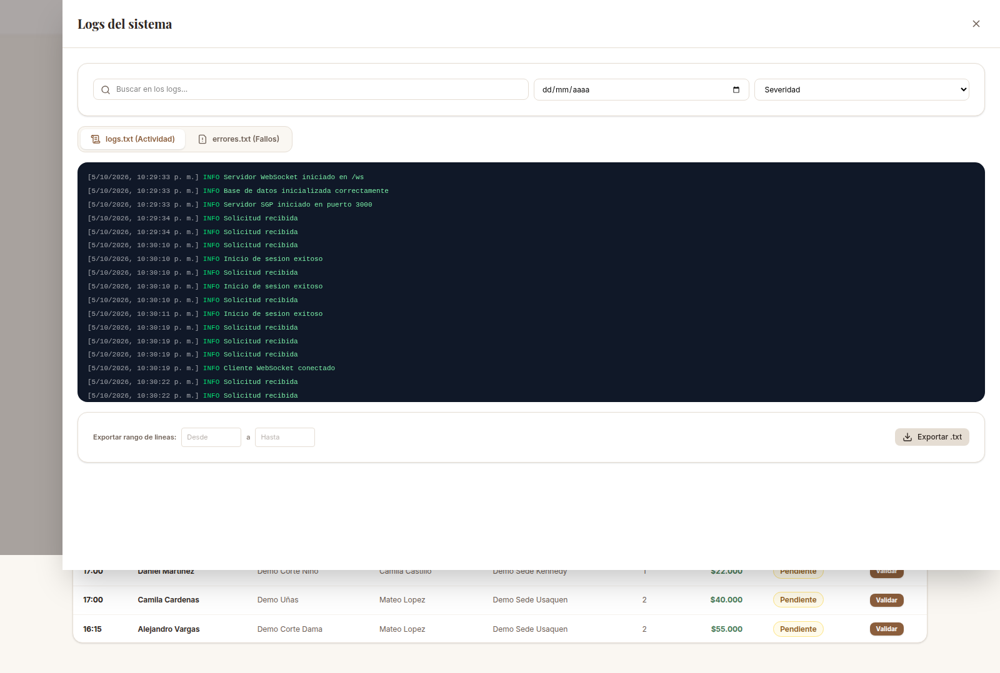

## 5. Uso en móvil e inglés

La interfaz es responsiva (menú hamburguesa, tablas con scroll y planificador con desplazamiento horizontal) y se muestra siempre en español.

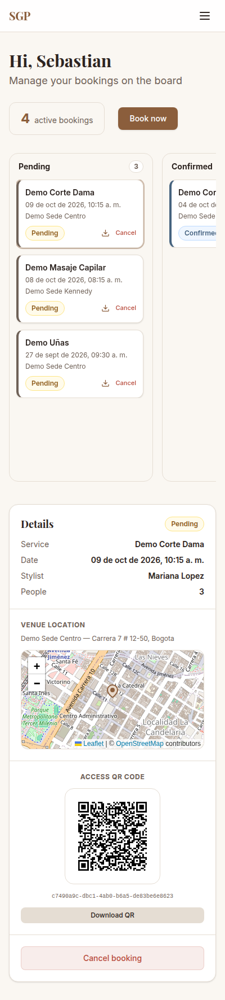

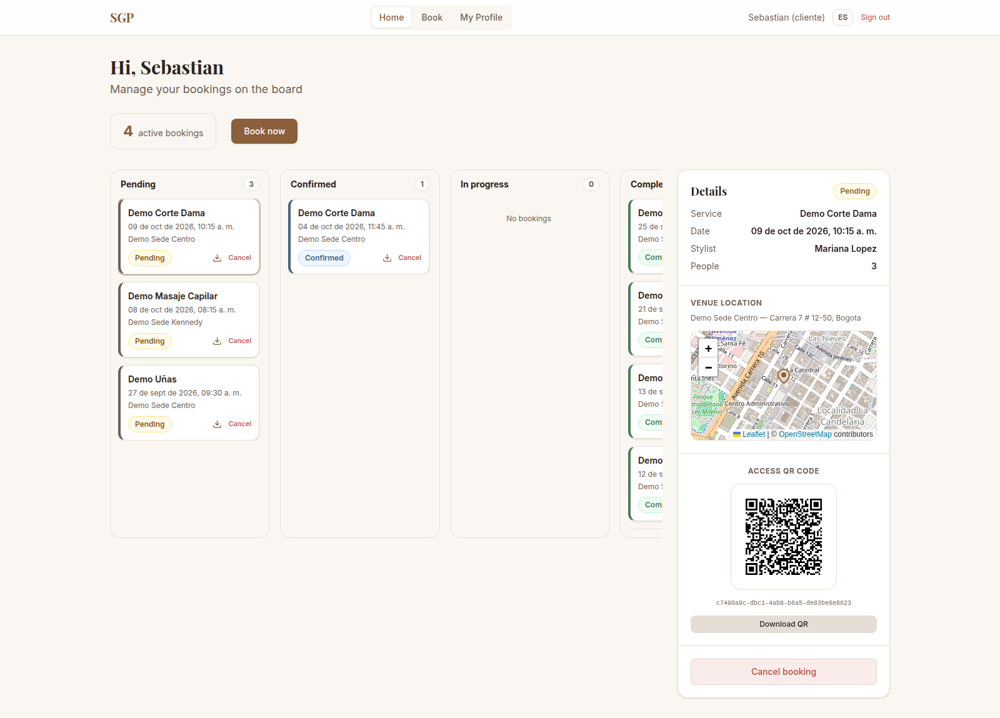

## 6. Preguntas frecuentes

| Pregunta | Respuesta |
|----------|-----------|
| ¿Por qué no puedo reservar en menos de 60 minutos? | Es la anticipación mínima para preparar el servicio. |
| ¿Qué pasa si el estilista cambia de sede? | Las reservas futuras de ese día en la sede anterior se cancelan y lo verás en tu kanban con el motivo. |
| ¿Cómo pago en línea? | Al reservar elige **Pago en línea** y completa el checkout de Wompi (tarjeta, PSE, Nequi o Bancolombia). También puedes pagar después desde **Pagar en línea** en el detalle de tu reserva. Si se aprueba, la reserva queda confirmada y pagada; si se rechaza, puedes reintentar o pagar en el local. |
| ¿Cómo pago al llegar? | Si no pagaste antes, el empleado genera un **QR de pago** para que lo escanees con tu celular, o registra el pago en efectivo. El servicio inicia cuando el pago esté resuelto. |
| ¿No me llegó el código? | Usa "Reenviar código" (máx. 3 cada 15 min) o revisa spam. |
| ¿Por qué desapareció mi registro? | Los registros sin verificar se eliminan a los 5 minutos; el correo queda libre para registrarte otra vez. |
| ¿Puedo tener muchas reservas? | Máximo 5 activas por cliente. |
