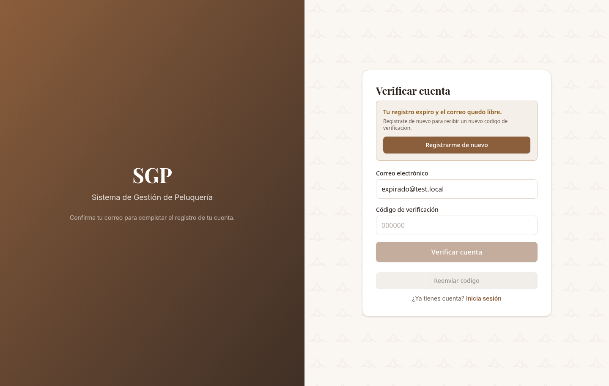
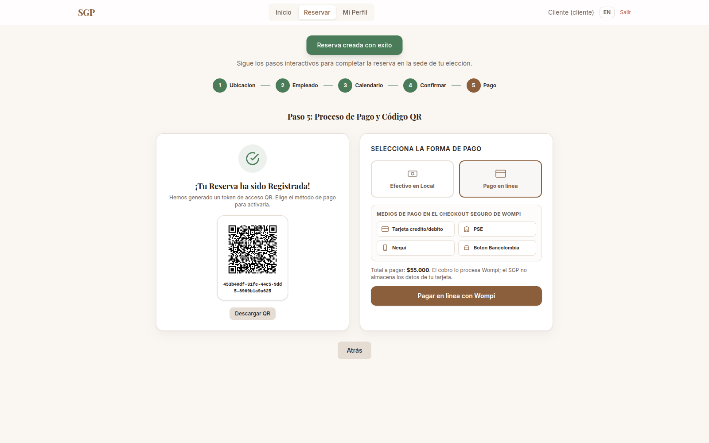
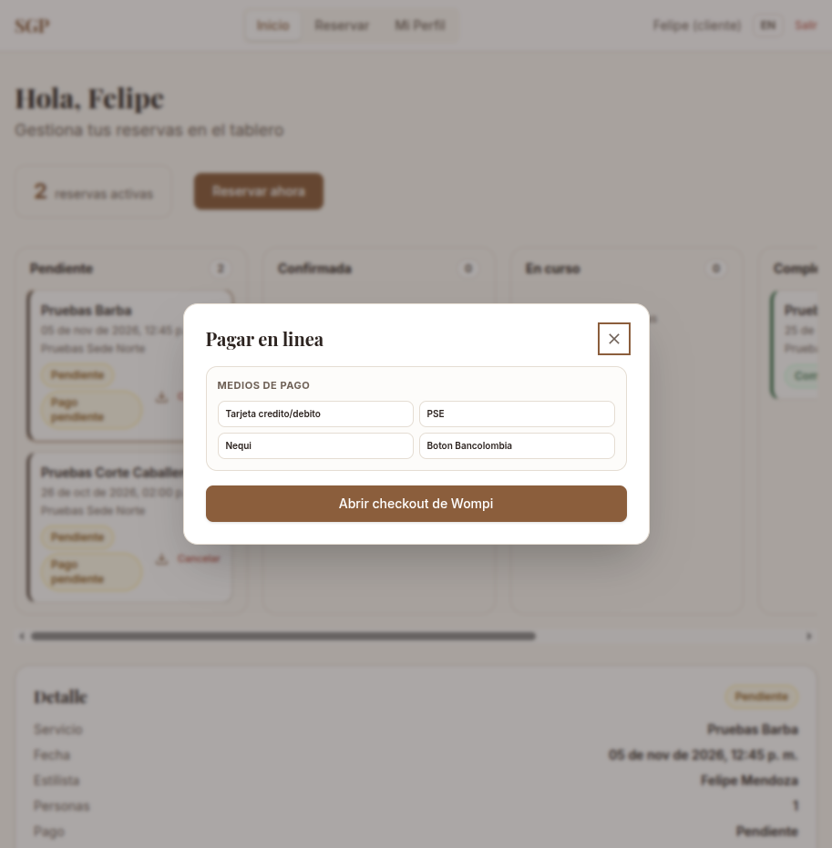
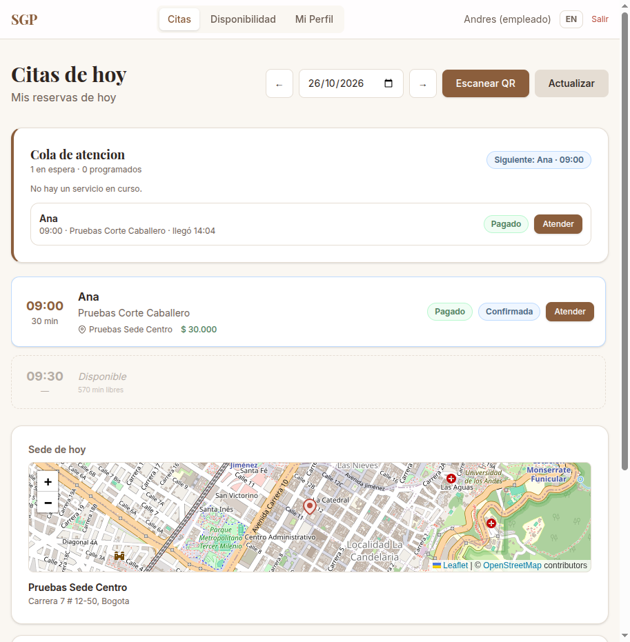
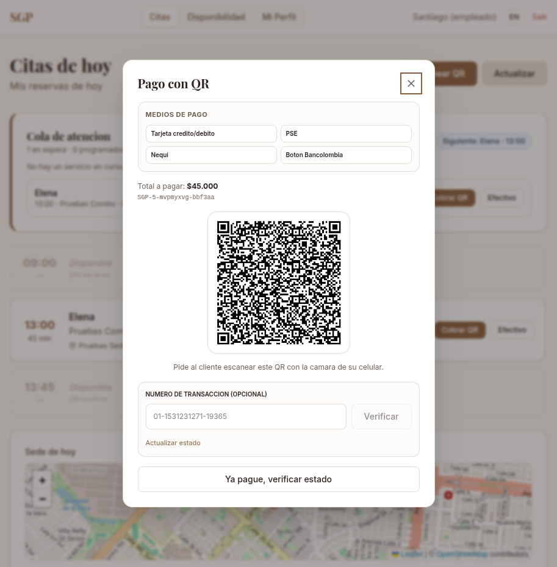
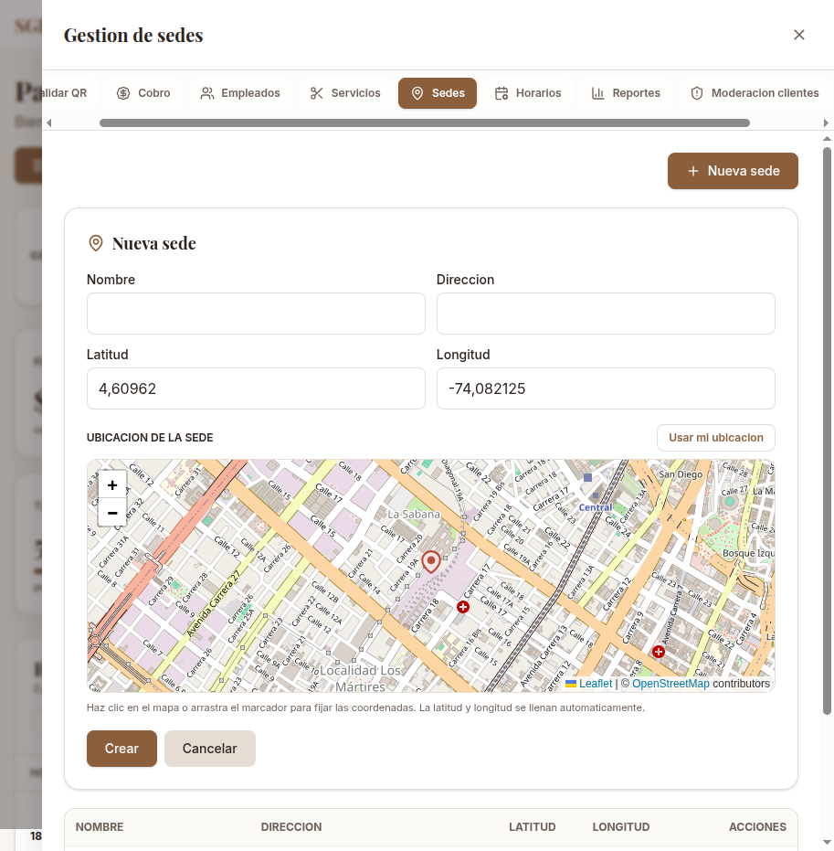
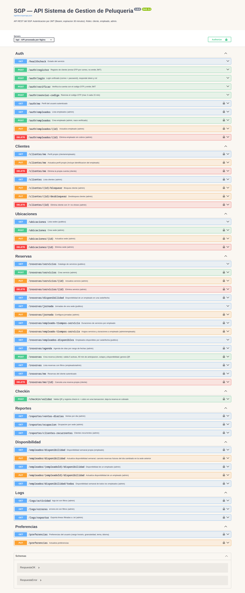

# Mockups e interfaz — SGP

> Nota: la interfaz fue rediseñada en 2026. La guía vigente de dirección, tokens, rutas y componentes está en [`docs/diseno/nueva-interfaz.md`](diseno/nueva-interfaz.md). Las capturas de este documento conservan la versión anterior como referencia histórica.

Capturas reales de la aplicación desplegada (Chromium, 1600×1000 salvo móvil 400×900). Sirven como mockups del producto final y como manual visual. Todas las imágenes están en `docs/img/`.

## Guía de estilo

| Token | Valor | Uso |
|-------|-------|-----|
| Fondo | `#FAF7F2` | Fondo general |
| Superficie | `#FFFFFF` | Tarjetas y paneles |
| Borde | `#E5DDD3` | Bordes y separadores |
| Primario | `#8B5E3C` | Acciones y marca |
| Secundario | `#C9A96E` | Acentos |
| Texto | `#2D2420` / `#6F6157` | Principal / secundario |
| Éxito / Alerta / Error | `#4A7C59` / `#8F5E1D` / `#B84C3D` | Estados |
| Tipografía | Playfair Display (títulos), Inter (texto) | — |
| Densidad | Tablas con cabecera sticky y scroll interno; sheets de 95 vw con riel de secciones y planificador de 95 vw | Responsive ≥320 px |

## 1. Autenticación y registro

### 1.1 Inicio de sesión unificado (`/login`)
Formulario único correo/contraseña; el backend decide el rol y redirige. Mensaje específico si la cuenta no está verificada con acceso a "Verificar mi cuenta".

### 1.2 Registro de cliente (`/register`)
Nombre, apellido, teléfono `+57` (10 dígitos), correo y contraseña con confirmación.

### 1.3 Verificación por OTP (`/verificar`)
Código de 6 dígitos con cuenta regresiva de **5 minutos** (`REGISTRO_TTL_MINUTOS`): si el registro expira, la cuenta se elimina, el correo queda libre y se ofrece "Registrarme de nuevo". El reenvío reinicia el tiempo (máx. 3 cada 15 min).

## 2. Rol cliente

### 2.1 Kanban de reservas (`/cliente`)
Columnas por estado (pendiente, confirmada, en curso, completada, cancelada), panel de detalle con mapa Leaflet de la sede y descarga de QR.

### 2.2 Reserva paso 1 — sede (`/cliente/reservar`)
Buscador de sedes, filtro por ciudad y mapa con marcadores.

### 2.3 Reserva paso 3 — calendario
Grilla de 6 días con estados: disponible, ocupado, pasado, no disponible y anticipación menor a 60 minutos.

### 2.4 Reserva paso 4 — ventana flotante
Servicio, duración estimada `entrada → salida`, cantidad de personas (1–5) y total.

### 2.5 Reserva paso 5 — pago y QR
QR de ingreso, elección entre **Efectivo en Local** y **Pago en línea**, guía de medios aceptados (Tarjeta, PSE, Nequi, Botón Bancolombia) y apertura del **Widget de Wompi** embebido. Al aprobarse el pago, la reserva queda confirmada con pantalla de éxito y QR; el kanban muestra la insignia "Pagado".

### 2.6 Pago pendiente desde el tablero
El detalle de una reserva sin pago muestra la insignia **Pago pendiente**, el total y el botón **Pagar en línea**, que abre el checkout de Wompi sin volver al paso 5.

### 2.7 Perfil (`/cliente/perfil`)

### 2.8 Interfaz en inglés y móvil
Conmutador ES/EN en la barra de navegación; menú hamburguesa y layout apilado en móvil.

## 3. Rol empleado

### 3.1 Citas y cola de atención (`/empleado`)
La cola muestra al cliente en atención, los que están en espera y las citas programadas, con nombre, hora, estado de pago y botones para iniciar, cobrar o finalizar. Si el servicio termina antes, se habilita al siguiente cliente sin esperar la hora.

### 3.2 Pago con QR en recepción
Si el cliente no pagó antes, el empleado genera un QR de Wompi; el cliente lo escanea con su celular y el pago se concilia por webhook. También puede registrar el cobro en efectivo.

### 3.3 Disponibilidad semanal (`/empleado/disponibilidad`)
Grilla semanal por sede, servicios asignados con duración y leyenda; una sede por día.

## 4. Rol administrador

### 4.1 Dashboard (`/admin`)
KPIs reales, timeline de todas las sedes y tarjeta de Gestión con los 9 accesos. Todas las ventanas flotantes (Validar QR, Cobro, Empleados, Servicios, Sedes, Horarios, Reportes, Moderación de clientes y Logs) incluyen un riel lateral con las 9 secciones como guía de uso: permite saltar entre secciones sin cerrar la ventana. En móvil el riel se convierte en chips con scroll horizontal y el sheet ocupa el ancho completo.

### 4.2 Planificador de horarios por empleado
Matriz empleados × LUN–DOM con sede por día, citas superpuestas y filtros.

### 4.3 Editor de celda del planificador
Selección de sede única por día, horario o descanso, con aviso RF9 al cambiar de sede.

### 4.4 Jornada por sede
Matriz semanal: navegación `◀ semana ▶ Hoy`, filas por semana (2 anteriores y 2 siguientes a la actual) y columnas LUN–DOM con la fecha. Cada celda muestra el horario de atención (`09:00-18:00`) o "Sin jornada"; al hacer clic se abre el editor del día (hora inicio/fin, Guardar, Cerrar día). En móvil los días se muestran como tarjetas apiladas con botón Editar.

### 4.5 Mapa al crear una sede
El formulario de sedes incluye un mapa Leaflet/OpenStreetMap: clic, arrastre del marcador o **Usar mi ubicación** llenan latitud y longitud automáticamente.

### 4.5 Gestión de empleados
CRUD con sedes, horarios por sede/día y servicios con duración.

### 4.6 Reportes
Ventas diarias con desglose, ocupación por sede y clientes recurrentes.

### 4.7 Logs
`logs.txt`/`errores.txt` con búsqueda, fecha, severidad y exportación `.txt`.

## 5. Documentación de API

Swagger UI en `/api/docs` con todos los endpoints y esquemas.

